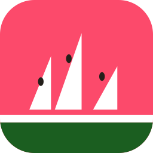
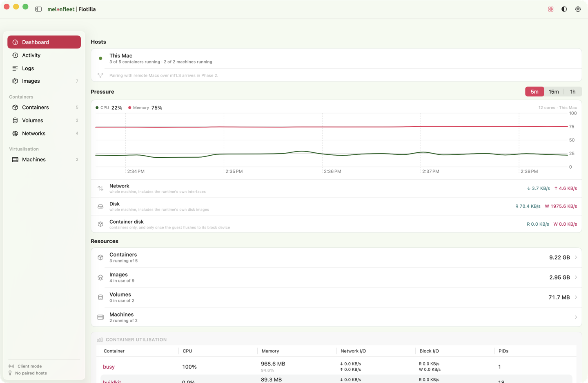
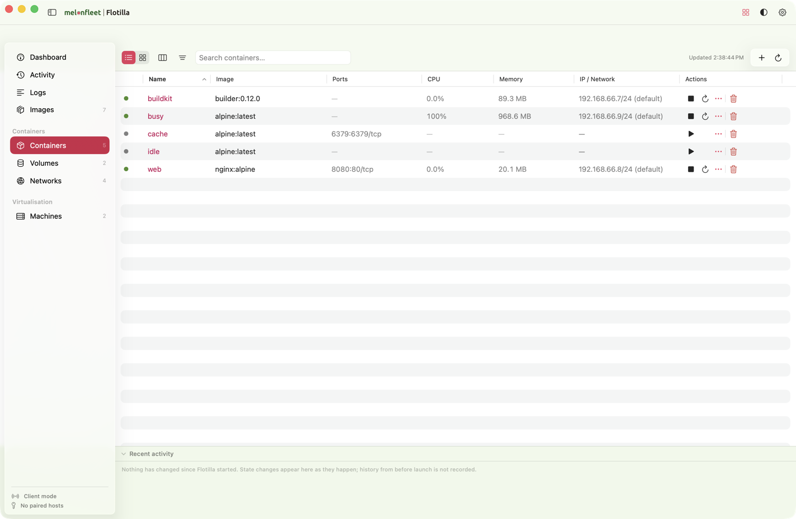
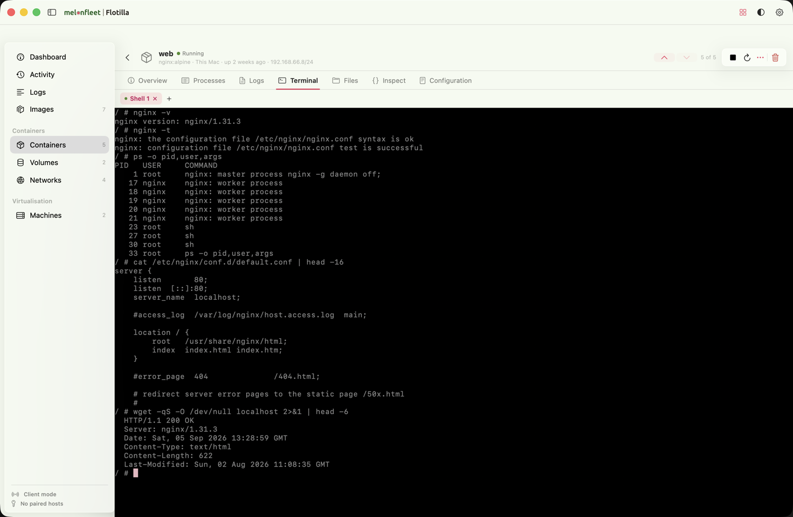
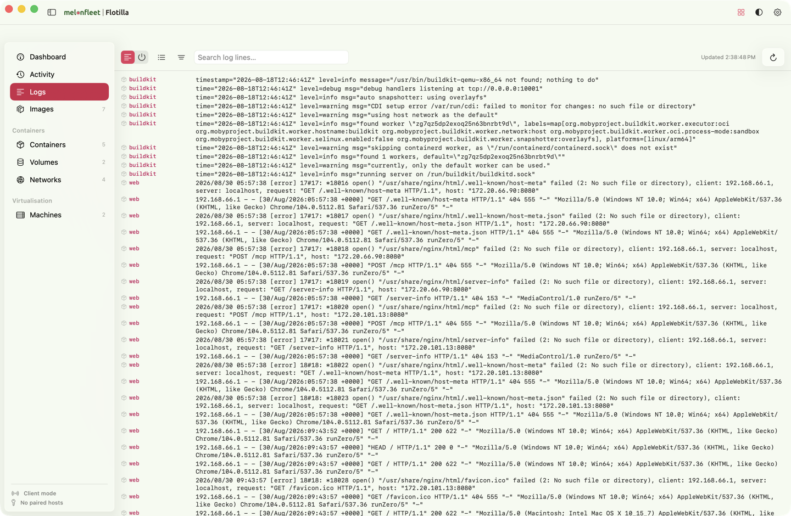
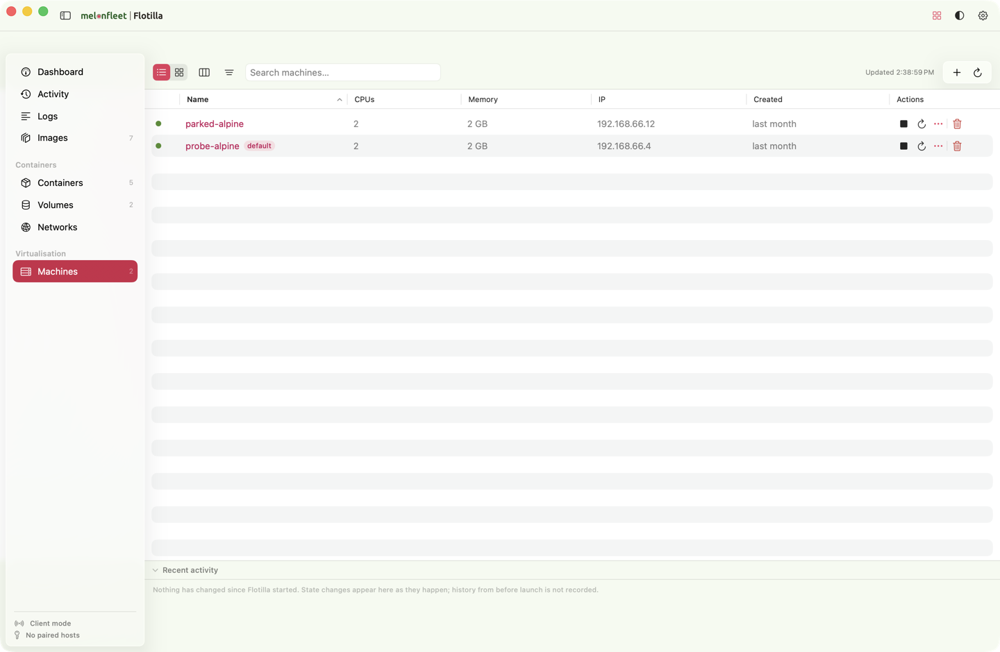

<p align="center">
  
</p>

<h1 align="center">Flotilla</h1>

<p align="center"><strong>Apple's containers, with a window.</strong></p>

<p align="center">
  Apple shipped <code>container</code> for macOS and left it on the command line.<br>
  Flotilla is the native app on top: containers, images, volumes, networks and the<br>
  virtual machines they run inside — plus a real terminal in every container.
</p>

<p align="center">
  <a href="https://github.com/melonfleet/flotilla/actions/workflows/ci.yml"></a>
  
  
  
  
  
  <a href="LICENSE"></a>
</p>

<p align="center">
  
</p>

---

## What it is

A **native SwiftUI app** that drives Apple's own `container` CLI. It does not link the
Containerization framework and it does not reimplement the runtime — it builds a command,
validates it against a default-deny allowlist, runs it, and decodes the JSON. Flotilla shows you
the exact command it used, so nothing happens that you could not have typed yourself.

One Mac can also manage others. An **admin** Mac pairs with **host** Macs over mutual TLS on your
own network, with no server in between, and each host checks every command against its own
allowlist before it runs it.

Free. No account, no sign-in, no telemetry, no subscription, no paid tier.

## Requirements

| | |
|---|---|
| **macOS 26 or later** | On Apple silicon. Apple's container runtime needs both, so Flotilla does too. |
| **Apple's `container` CLI** | Version 1.5.0, from [apple/container](https://github.com/apple/container). Flotilla drives that tool; it does not bundle or replace it. If it is missing, Flotilla offers to download Apple's signed package and hand it to Apple's Installer, and it will offer to start the runtime service if it is not running. |
| **Nothing else** | No account, no telemetry, no background phone-home. Even the wordmark is drawn in SwiftUI rather than loaded as a webfont. On an admin Mac, Sparkle reads Flotilla's appcast on GitHub Pages, and asks you once before it checks by itself; a host is updated by its admin and never checks. Docker Hub is asked only when you open its browser, Apple's package is downloaded only when you install it, and other Macs are reached only once paired. Nothing about you or your Mac is sent. **Settings → About** lists every address and when. |

## Getting it

**Flotilla 1.5.0.0 is in beta.** Each release on
[GitHub Releases](https://github.com/melonfleet/flotilla/releases) is signed with Developer ID and
notarised, in four forms: a DMG to drag to Applications, a `.pkg` for MDM and scripted installs, and
a zip and a tarball of the same app. From then on an admin Mac updates itself with Sparkle (betas
only on the pre-release channel, in **Settings → Updates**) and updates its hosts.

To build it yourself:

```sh
git clone https://github.com/melonfleet/flotilla.git
cd flotilla
Scripts/make-app.sh          # assembles build/Flotilla.app
open build/Flotilla.app
```

`Scripts/make-app.sh` signs ad-hoc, which is fine locally. Note that macOS may refuse
login-item registration for an ad-hoc-signed bundle — that is expected, not a bug. For the same
reason an ad-hoc build cannot use the Flotilla Helper, which accepts only a Developer ID-signed app
of its own team. `RELEASING.md` documents the signed-and-notarised path.

## What it looks like

| | |
|---|---|
|  | **Containers.** Live CPU and memory per container, published ports, addresses, and start/stop/delete on the row. Switch to cards if you prefer. |
|  | **Terminal.** A real shell inside any running container or machine — test a config, read the process table, ask it for a page, without leaving the window. |
|  | **Logs.** Every source in one feed, each line tagged with where it came from, filterable by name or text. No tab-hopping between containers. |
|  | **Machines.** The virtual machines your containers actually run inside — create, resize, start, stop, and open a shell in one. |

## How it works

```text
SwiftUI app  ──▶  ContainerCLI  ──▶  Allowlist  ──▶  ContainerHost  ──▶  container(1)
                                         │
                        MountPolicy · ExecPolicy · WirePolicy
```

`ContainerHost` is the execution spine. UI code never constructs a raw command and never cares
whether a host is local or remote. Every execution crosses the **`Allowlist`** — a default-deny
table of 66 command specs with typed argument shapes — and the capability policies that apply.

Three policies are injected per executor rather than hardcoded, so the same core can be built
strictly or permissively depending on who is asking:

- **`MountPolicy`** — which host paths may be bind-mounted. Default is deny.
- **`ExecPolicy`** — whether an interactive shell grammar is reachable at all. `exec <id> sh` is
  refused by default; the terminal works because the app builds a CLI carrying
  `.interactiveShell` for the machine's own owner.
- **`WirePolicy`** — which subcommands a remote peer may reach, for commands that no argument
  shape can refuse.

Two supporting rules the project holds to, both learned the hard way and documented at the code:

- **Fixtures are captured from the real CLI, never written.** A hand-written `Tests/.../Fixtures/volumes.json` once
  matched the models instead of reality, so the decoder threw the moment a real volume existed —
  with a green test suite throughout.
- **A control either works or is visibly disabled with the reason stated.** An independent audit
  found 11 of 26 settings read by nothing; `Scripts/check-settings-consumers.sh` now fails the
  build if a setting marked available has no consumer.

## Status

Working Swift code, not a starter kit. The current build is **1.5.0.0 beta 4**, tested against
`container` 1.5.0. **828 tests pass** — run `swift test` for the current number rather than
trusting this one.

**Built, on one Mac:** containers, images, volumes, networks, machines and Kubernetes clusters with
full lifecycle; groups and ready-made Suggestions; registries and a Docker Hub browser; DNS domains;
an aggregated log feed that follows live; a live host dashboard; embedded container and machine
shells; a validated live command preview in the Run form; notices in the window and in
Notification Centre; a typed settings registry with managed `defaults`/`locked` precedence;
diagnostics snapshots with redaction and a support bundle.

**Built, across Macs:** an admin Mac manages its hosts over mutual TLS — found by Bonjour or added
by address, each Mac trusted by its own key and approved on the admin, with no certificate
authority. From the admin you run and manage containers on any host, follow their logs live, pull
or send images, push networks and volumes, give each Mac a DNS zone whose names resolve across
Macs, start and stop a host's `container`, and manage its clusters. The admin updates itself with
Sparkle and pushes its own build to its hosts one at a time; a host installs only a newer Flotilla
signed by its own team, only when idle, and never touches running containers.

**The Flotilla Helper** is optional, approved once in Login Items, and the only thing that runs as
root: DNS domains, the resolver files for names across Macs, installing Apple's `container`
package, and installing an update over a root-owned app. It takes typed requests, never a command
line.

**Not built** — stated here because a settings screen is a poor place to discover it:

- **Networking between Macs.** Containers on different Macs reach each other through published
  ports only; an overlay is 2.0 work. A host's Kubernetes cluster is reached with `kubectl` on
  that host, not from the admin Mac.
- **Zero-touch hosts.** A new host needs one click on macOS's Local Network prompt, which no
  configuration profile can grant, and host mode runs in a logged-in user session, so a headless
  Mac needs automatic login. Per-device identities and trust by profile are 2.0; today a profile
  sets managed `defaults` and `locked` preferences.
- **Cancelling a command.** A bounded command that is cancelled, on this Mac or from an admin,
  runs on to its deadline, because `ContainerHost.run` cannot be cancelled yet. Live logs are
  streams, and do stop when closed.
- **App-layer tests.** The test targets cover `FlotillaCore`, the trust layer and the transport,
  not the SwiftUI app, which is why decisions that matter are pushed down into the core —
  `DeletePolicy` lives in the core, not in the views.

## Development

**macOS** — Apple silicon, macOS 26, Swift 6.2 or newer. The unit tests use captured fixtures
and do not need `container` installed.

```sh
swift build
swift test
swift run Flotilla
swift run flotilla-probe     # exercises the live container JSON surface
```

**Linux** — Swift 6.1. SwiftPM selects `Package@swift-6.1.swift`, which exposes only the
Foundation-only core, the probe and the tests. `FlotillaCore` is kept free of SwiftUI, AppKit,
Network.framework and Security precisely so that core and data work stays independently
verifiable off a Mac.

```sh
swift build
swift test
```

**Invariant checks** — a few things the compiler cannot check are enforced by script, and each
one exists because it already went wrong once:

| Script | What it refuses to let through |
|---|---|
| `Scripts/check-settings-consumers.sh` | a setting marked available with no code reading it |
| `Scripts/check-defaults.sh` | a screenshot scaffold or wrong `@State` default reaching a build |
| `Scripts/check-test-isolation.sh` | a test that passes only because another test ran first |
| `Scripts/check-hygiene.sh` | real identity, credentials or key files in tracked files |
| `Scripts/check-tooltips.sh` | an icon-only button or menu with no tooltip, an empty tooltip, or a `.help` on a segmented picker |
| `Scripts/check-history.sh` | the same, anywhere in the git history — run before publishing |

## Documentation

The [**Wiki**](https://github.com/melonfleet/flotilla/wiki) is the place to start for using the
app. In the repository:

| File | What it holds |
|---|---|
| `DECISIONS.md` | settled product and security choices, with the rejected alternatives |
| `RELEASING.md` | signing, notarisation and stapling, end to end |
| `CLAUDE.md` | project orientation, architecture, and hard-won lessons |
| `research/` | the background studies the scope was derived from |
| `reference/cli-help/` | captured `--help` for every `container` subcommand — 63 files, the allowlist's source of truth |

## Licence

**Apache-2.0** — see [`LICENSE`](LICENSE). The same licence Apple uses for
[`container`](https://github.com/apple/container) itself, so there is no compatibility question
either way.

The names and marks are reserved separately and are **not** covered by it: *Flotilla*,
*melonfleet*, the wordmark and the app icon. Fork the code freely; give the fork its own name, so
nobody is left guessing which build they are running. Details in [`NOTICE`](NOTICE).

---

<p align="center">
  <a href="https://melonfleet.dev">melonfleet.dev</a> ·
  <a href="https://github.com/apple/container">apple/container</a> ·
  no cookies, no analytics
</p>
